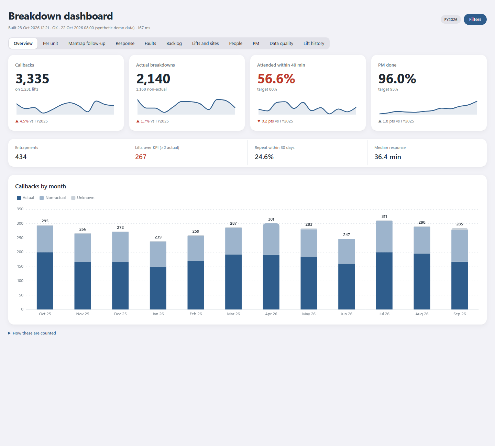
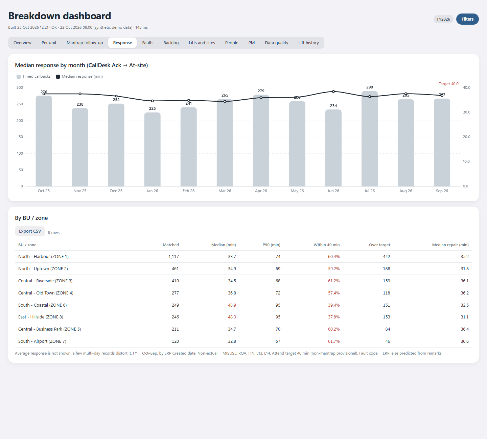
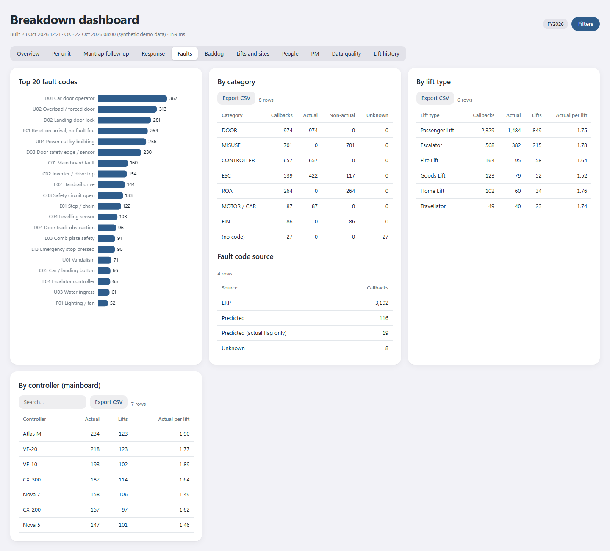
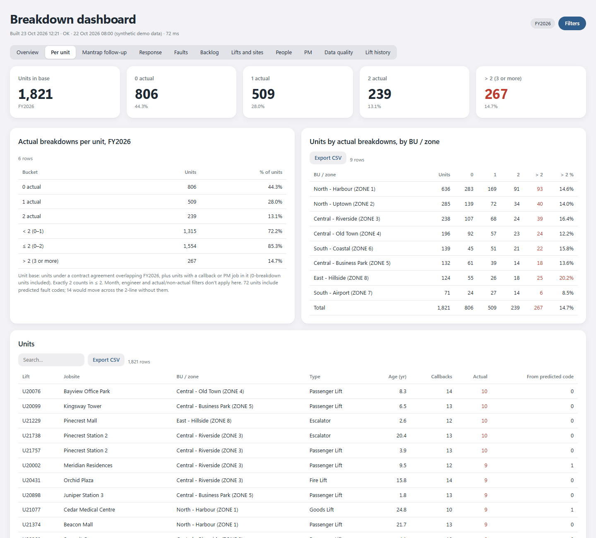

# Lift breakdown analytics

[](https://github.com/muhd-muaz/lift-breakdown-analytics/actions/workflows/demo.yml)

A daily reporting pipeline for a lift and escalator service business: breakdown callbacks, mantraps (passengers
trapped), attend time against a 40-minute target, repeat calls, preventive maintenance (PM) completion and backlog.
It turns raw ERP work orders and call-centre tickets into one offline HTML dashboard and two month-end PDF reports.

> **All data in this repository is synthetic.** "Acme Lifts", its sites, units, staff and numbers are generated by
> `generate_fake_data.py` from a seeded random generator. The production version runs on real company data that
> is not published here.



## What it does

| Output | What it answers |
| --- | --- |
| `Breakdown Dashboard.html` | One self-contained file (works offline, no server). 11 tabs: overview KPIs with sparklines and change vs the prior FY, actual breakdowns per unit (KPI: no more than 2 per unit per year), mantrap follow-up list, attend-time distribution by zone, fault Pareto, backlog ageing, sites, engineers, PM, data quality, single-lift history. Filters by FY, month, zone, state, sector, lift type, engineer. |
| `month-end/… Breakdown Pack YYYY-MM.pdf` | One-page management pack: month and FY-to-date KPIs, trends, late mantraps. |
| `month-end/… Monthly Breakdown Report YYYY-MM.pdf` | One section per KPI in a *What / Why / What now* format, compared with the previous month and the same month last year, with the biggest movers by zone, site and fault. |

| Attend time | Faults | Per unit |
| --- | --- | --- |
|  |  |  |

## How the production pipeline works

```
ERP REST API (read-only, NTLM) ─┐                         ┌─> HTML dashboard (ECharts, inlined, offline)
                                ├─> SQLite raw store ─> star schema ──> month-end PDF pack (HTML -> headless Edge)
Call-centre ticket API ─────────┘   (incremental,       (dim_lift,     └─> monthly What/Why/What-now report
                                     keyset paging)      fact_callback, fact_pm, ...)
```

- **Extract**: GET-only pulls with keyset paging and a resumable backfill (5 years of history). Runs at 09:00 on
  weekdays from Task Scheduler and retries hourly if the ERP is down.
- **Transform**: callbacks are matched to call-centre tickets to get attend time (Ack to At-site). Fault codes
  decide *actual* vs *non-actual* breakdowns (misuse, reset on arrival and finishes are non-actual). Callbacks
  that have no fault code yet get one predicted from the engineer's remarks by a small scikit-learn text
  classifier, flagged as predicted everywhere they're counted.
- **Report**: the financial year runs October to September, and every number uses the callback's created date.
  Each page footnotes its basis.

This repository contains the **reporting layer** (dashboard and both PDFs) plus the synthetic data generator.
The extractors and the classifier are left out because they're tied to the private systems.

## Run the demo (Windows, Python 3.11+, Microsoft Edge)

```bash
pip install pandas
python build_demo.py            # fake data -> dashboard -> both PDFs for Sep 2026
python build_demo.py 2026-08    # another month
```

Then open `Breakdown Dashboard.html` in any browser. The PDFs are printed by headless Microsoft Edge.

## Layout

```
generate_fake_data.py   synthetic company: 1,860 units, 420 sites, ~15k callbacks over 5 FYs, monthly PM
build_demo.py           runs everything
src/build_html.py       model tables -> one self-contained HTML (data dictionary-encoded, ECharts inlined)
src/dashboard/          page template + vendored ECharts 5.5.1 (Apache-2.0)
src/month_end_pdf.py    month-end pack
src/monthly_report.py   What / Why / What now report
docs/                   screenshots
```

## Design notes

- One accent colour (red), used only for breaches: over target, over KPI, PM missed. Good states stay neutral so
  red stands out.
- KPI cards show the value, the target, a 12-month sparkline and the change against the same months of the
  prior FY.
- Tables right-align numbers, use tabular figures, and are sortable and searchable, with CSV export.

## Licence

MIT for this code (see `LICENSE`). ECharts is Apache-2.0 (`src/dashboard/vendor/ECHARTS_LICENSE.txt`).
